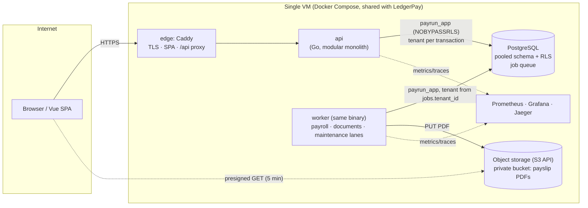

# PayRun

> Multi-tenant workforce and payroll platform: one database, many companies, and no tenant can ever see another tenant's data.

**Status:** M7 code-complete (Sprints 0–10): tenancy with forced row-level security, employees with encrypted PII, effective-dated compensation, a pure payroll engine with 33 golden cases, async and resumable payroll runs, approval with stale detection, attendance/leave/overtime, finalize with period lock, payslips (web + deterministic PDF), post-final adjustments, observability, demo mode, backups with a restore drill, and a laptop performance baseline. Deployed on one 2 vCPU / 4 GB VM together with LedgerPay. Still owed: performance numbers on that VM ([DoD audit](docs/dod-audit.md)).

**Live demo:** https://payrun.suyantolabs.my.id (one click on *Coba demo* creates a demo company with three roles; no sign-up)

**Demo video:** https://suyantolabs.my.id/video/payrun.mp4 (2 min, Indonesian narration)

Production-oriented, small in scope, strict about isolation and reproducibility. Built for learning and as a portfolio project.

---

## In 60 seconds

- **Tenant Beta asks for an employee of tenant Alpha** (even with an edited token or a `tenant_id` in the body) → `404`, and the database itself returns zero rows: every query runs under PostgreSQL row-level security as a role that cannot bypass it.
- **Kill the worker in the middle of a 100-employee payroll run** → another worker resumes after the lease expires; exactly one item per employee, and the run total equals the sum of items.
- **Change a salary after the run was calculated** → approve is rejected with `RUN_STALE` and the list of changed employees. After finalize, a backdated change is rejected with `PERIOD_LOCKED`, and any finalized run can be recomputed from its stored snapshots to the rupiah.

## What this demonstrates

| Problem | Guarantee | How | Proof |
|---|---|---|---|
| One forgotten `WHERE tenant_id = ?` leaks a company's payroll | Isolation does not depend on every query being right | Pooled schema + `ENABLE`/`FORCE ROW LEVEL SECURITY` on every tenant table, app connects as `payrun_app` (`NOBYPASSRLS`, not the owner, checked at startup), tenant set per transaction with `set_config(..., true)`; no tenant → zero rows ([ADR-P01](docs/adr/ADR-P01-multi-tenancy-pooled-rls.md), [ADR-P02](docs/adr/ADR-P02-tenant-context.md)) | `TestRLS_UnfilteredQuerySeesOnlyActiveTenant`, `TestRLS_NoContextReturnsZeroRows`, `TestRLS_PoolLeakageAfterCommit`, `TestCatalog_EveryTableHasForcedRLS`, `TestCrossTenant`, Demo A |
| A reference to another tenant's row (department, manager, run) | Cross-tenant references are impossible | Composite foreign keys `(tenant_id, id)` on every tenant relation; repositories compare each decoded row's `tenant_id` (C-46) | `TestCatalogue_TenantFKsComposite`, `TestTenantIsolation_DemoA`, `TestJob_TenantRunMismatch_NoOpAndAlert` |
| Role checks scattered across handlers | Every route has an explicit authorization rule | Authorization matrix as data (`backend/api/authz_matrix.yaml`); a route without a row fails CI; sensitive operations re-read roles from the DB ([ADR-010](docs/adr/ADR-010-authorization.md)) | `TestAuthzMatrix`, `TestAuthzMatrix_CoversEveryRoute` |
| Payroll math that is "almost right" | Deterministic, explainable results, no floats | Pure engine (no DB, clock or randomness; enforced by `depguard`), decimal with explicit rounding, versioned ruleset ([ADR-P03](docs/adr/ADR-P03-payroll-engine.md), [ADR-P06](docs/adr/ADR-P06-decimal-rounding.md)) | `TestGolden` (33 cases), `TestTonoMarch2026_LineByLine`, `TestProperty_Invariants` |
| A worker dies halfway through a 10,000-employee run | Resume without duplicates or gaps | Run split into chunk jobs; each chunk reads in one snapshot, computes outside a transaction, writes in one transaction with **fenced** completion and `calc_version` ([ADR-P05](docs/adr/ADR-P05-payroll-run-execution.md)) | `TestPayrollRun_WorkerKilledMidChunk_ResumesWithoutDuplicates`, `TestPayrollRun_CrashAndResume`, `TestCalcChunk_PanicExhaustsAttempts_RunFailed` |
| Two admins start the same month's payroll | One run per period | Partial unique index + idempotency keys; the loser gets `409 ACTIVE_RUN_EXISTS` pointing to the winner | `TestCreateRun_ConcurrentSamePeriod_SingleRun` |
| HR edits input while the run waits for approval | Approve only what was calculated | Every input writer records a change log under a period lock (`FOR SHARE`); approve takes the period `FOR UPDATE` and re-fingerprints only the changed employees ([ADR-P07](docs/adr/ADR-P07-snapshot-and-period-lock.md), [ADR-P09](docs/adr/ADR-P09-approval-workflow.md)) | `TestSubmit_InputChangedAfterCalc_ReturnsRunStaleWithEmployees`, `TestApprove_StaleDetectedForWriterCommittedAfterChunkRead`, `TestApprove_BlocksConcurrentInputWrite` |
| "Fixing" a finalized payroll | Final is final; corrections are visible | Triggers reject any change to finalized runs and to dates inside a finalized period; corrections become adjustments in the next period | `TestFinalizedRun_DirectUpdateRejected`, `TestPeriodGuard_FinalizedPeriodRejectsInputWrites`, `TestAdjustment_AppliedOnce` |
| "Prove January's payroll was right" | Any finalized run can be recomputed | Each item stores its input snapshot + ruleset version; `payrun verify-run` recomputes and diffs; a job verifies every run after finalize and feeds the invariant metrics | `TestRecompute_FromSnapshotMatchesStoredResults`, `TestVerifyRunJob_AfterFinalize_FeedsInvariantMetrics` |
| ID numbers and bank accounts in a breached dump | PII unreadable without the key; still unique per tenant | AES-256-GCM bound to tenant + column (AAD), separate HMAC blind index, masked by default, full view audited and rate-limited ([ADR-P08](docs/adr/ADR-P08-pii-encryption.md)) | `TestEmployee_PIIMaskedAndEncryptedAtRest`, `TestEmployee_NikUniquePerTenant` |
| Payslips leaking through shared URLs | Only the employee or an audited admin can download | Private bucket, deterministic object key, presigned URL for 5 minutes after an authorization check ([ADR-012](docs/adr/ADR-012-object-storage.md)) | `TestPayslipAccess_Matrix`, `TestPayslipPDF_DeterministicBytes`, `TestPayslipRender_CrashMidBatch_ResumesIdempotently` |

## Architecture



One Go binary runs as `api` and `worker`. The tenant comes from the signed token (`tid` claim), never from the request body; every business query runs inside `WithTenantTx`, which sets `app.tenant_id` for that transaction only, so a pooled connection cannot carry a tenant into the next request. Jobs carry their own `tenant_id` (checked by a trigger at enqueue) and run under the same RLS. More: [docs/architecture.md](docs/architecture.md).

## Key design decisions

- **Pooled multi-tenancy with forced RLS**, not schema-per-tenant: one migration path, and isolation enforced by the database for every query ([ADR-P01](docs/adr/ADR-P01-multi-tenancy-pooled-rls.md)).
- **Modular monolith** with module boundaries enforced by `depguard`; the payroll engine may not import the database, the clock, or `math/rand` ([ADR-001](docs/adr/ADR-001-modular-monolith.md)).
- **Effective dating with `daterange` + `EXCLUDE`** for salary, components and org placement: overlapping records are impossible, history is never overwritten ([ADR-P04](docs/adr/ADR-P04-effective-dating.md)).
- **PostgreSQL-backed job queue** with leases and fencing, reused from LedgerPay and made tenant-aware ([ADR-006](docs/adr/ADR-006-background-processing-postgres-queue.md)).
- **Snapshot + change log instead of locking input during review**: HR keeps working; approve detects exactly what changed ([ADR-P07](docs/adr/ADR-P07-snapshot-and-period-lock.md)). Experiment E-2 confirmed approve can stay synchronous.

## Failure scenarios

| Scenario | Detection | Handling | End state |
|---|---|---|---|
| PFS-01 worker crash mid-chunk | Lease expiry | Chunk transaction rolled back; another worker reclaims | One item per employee |
| PFS-02/06 duplicate or concurrent execution | Idempotency key, unique index, `calc_version` | Replay / `409` / stale chunk is a no-op | One run, one result |
| PFS-03 input changes after calculation | Change log + fingerprints | Approve/finalize → `RUN_STALE` with the employees | Recalculate, then approve |
| PFS-04 connection lost before COMMIT | Transaction rolled back | Retry (job) or idempotent retry (finalize) | No partial write |
| PFS-05 chunk keeps failing | Attempts exhausted | Job dead → run `FAILED` with a reason; recalculate after fixing | No half-written run |
| PFS-07 bad configuration | Engine errors per item, component cycle check | Item `ERROR`; submit blocked until excluded or fixed | Explicit, never silent |
| PFS-09 job for another tenant | RLS hides the run | Job dead (permanent), alert | No data touched |
| PFS-10 crash while rendering payslips | Lease expiry | Resume; deterministic key overwrites the same bytes | Every slip rendered once |

Full list with tests: [traceability matrix](docs/design/25-testing-strategy.md#5-traceability-matrix).

## Run it

Requirements: Go (toolchain from `backend/go.mod`), Docker with Compose, Node 22 + Yarn (SPA), `jq`. Layout: Go module in `backend/`, Vue SPA in `frontend/`; run `make` targets from the repo root (they `cd` into the right folder), plain `go` commands from `backend/`.

```bash
make up                 # storage + postgres + migrations + api + worker (API 127.0.0.1:8081)
make web-dev            # SPA on http://localhost:5174 (proxies /api to the local API)
make test               # unit tests (no Docker)
make test-integration   # integration + interleaving tests (testcontainers, -race)
make demo-verify        # Demo A–C headless, with assertions (what the nightly job runs)

# Live demo on a separate stack (project payrun-demo, API :8082, own data; your dev data is untouched)
make up-demo && make seed-demo   # demo build tag + DEMO_MODE; two tenants (100 and 10–50 employees)
make demo-live                   # Demo A (isolation), B (worker killed mid-run), C (approve, finalize, locked)
make demo-down                   # remove the demo stack and its data

make up-obs             # + Prometheus and Grafana (http://localhost:3001)
make help               # all targets
```

If port 5174 is taken, run both with the same port: `PR_WEB_PORT=5175 make up` and `PR_WEB_PORT=5175 make web-dev` (the API checks the SPA origin for CSRF). Dev ports: API `127.0.0.1:8081`, ops `127.0.0.1:9190`, Postgres `127.0.0.1:55433` (chosen to run alongside LedgerPay).

Deploy to a VM: `deploy/prod/` (shared edge with LedgerPay, `init-env.sh` generates secrets, `deploy.sh <host> <sha>` migrates, health-gates, smoke-tests and rolls back automatically). Backups: `pg_dump` as `payrun_backup` (`BYPASSRLS`, `SELECT` only — a dump made with an RLS-bound role is silently empty), encrypted with age; `scripts/restore-drill.sh` restores into a throwaway Postgres, migrates, checks that tenant tables are not empty, and runs `verify-run` on every finalized run.

## Tech stack

| Area | Choice | Why |
|---|---|---|
| Backend | Go, chi, pgx, sqlc, oapi-codegen | Explicit SQL, compile-time checked queries, contract-first API ([ADR-002](docs/adr/ADR-002-tech-stack-go-vue.md), [ADR-003](docs/adr/ADR-003-rest-api-openapi.md), [ADR-005](docs/adr/ADR-005-data-access-sqlc.md)) |
| Database | PostgreSQL 17 | RLS, `EXCLUDE` constraints, deferred triggers, `SKIP LOCKED` ([ADR-004](docs/adr/ADR-004-postgresql.md)) |
| Frontend | Vue 3 + TypeScript + Vite | Access token in memory only, session restored from an HttpOnly cookie, tenant picker for multi-tenant users |
| Ops | Docker Compose, Caddy, S3-compatible storage, Prometheus, Grafana, OpenTelemetry | Single VM, everything provisioned from the repo |
| CI/CD | GitHub Actions | PR: lint (golangci-lint incl. gosec/depguard, Redocly, shellcheck, actionlint, promtool), unit, integration, migrations, gitleaks, govulncheck, trivy. main: build → scan → deploy → smoke → auto-rollback. Nightly: demo verification |

## Testing

- **About 200 Go tests**, integration tests against a real PostgreSQL (testcontainers, one cloned template DB per test) **as the application role**, so RLS applies exactly as in production. Vitest for the SPA's routing and access rules; the UI flows were exercised against the local stack (no Playwright suite in this project).
- **Golden + property tests** for the engine: 33 hand-checked cases (proration, effective-dated raises, overtime tiers, BPJS caps, tax brackets, rounding), 10,000 random inputs per property run.
- **Deterministic interleavings** with named test hooks (`-tags testhooks`): a writer committing after a chunk read, finalize racing a zombie chunk, a worker process killed right before COMMIT.
- **Catalogue tests** read `pg_catalog`: every tenant table has forced RLS, every tenant FK is composite, `SECURITY DEFINER` functions are on an allowlist, grants match a matrix.
- **The repo checks itself**: every test named in this README, the ADRs, the runbook and the traceability matrix must exist (`TestTraceability_DocsReferenceExistingTests`); every alert links to an existing runbook section (`TestObservability_AlertsLinkToRunbook`); alert rules and dashboards only use defined metrics; the release binary contains no demo or test-hook code (`TestBuild_DemoEndpointsAbsentWithoutDemoMode`).

## Observability

- Metrics: HTTP per route template, DB pool, job queue (lag, dead letters, oldest age per kind), payroll run and chunk duration, stale rejections, payslip renders, and **invariant metrics** that must stay 0 (isolation violations, writes stopped only by a trigger, total mismatches, non-reproducible items).
- Two provisioned Grafana dashboards (*Payroll & Tenancy*, *Platform*), alert rules tested with `promtool`, each linked to a section of the [runbook](docs/runbook.md).
- Traces: request → DB (sqlc query names only) → enqueued jobs; chunk jobs start a new root span linked to the calculate request.

Dashboards are provisioned from [`deploy/grafana/dashboards/`](deploy/grafana/dashboards/); `make up-obs` starts the stack locally with Grafana.

## Performance baseline

Measured on **one laptop** (Intel i3-1315U, 8 threads, k6 on the same machine) with 1,000 tenants / 100,000 employees. A laptop baseline for finding bottlenecks, not a capacity claim; numbers for the target VM will follow the deployment. Report and raw evidence: [perf/results/2026-10-10-fed1df1/REPORT.md](perf/results/2026-10-10-fed1df1/REPORT.md).

| Scenario | Load | Result | p95 | Invariants |
|---|---|---|---|---|
| PR-1 payroll run, 10,000 employees | 1 → 2 → 4 workers, chunk 50 | 13.8 → 10.3 → 10.0 s | — | one item per employee, Σ items = run total |
| PR-3 reads under RLS | open model, 227 req/s (~50% of saturation) | all routes pass | 10–20 ms | 0 rows of another tenant in 657,000 checked responses |
| PR-3 saturation | 300 VUs, no think time | ~450 req/s | queueing | ✅ |
| PR-4 / E-2 approve with stale detection | 10 / 200 changed employees | p50 25 / 44 ms | 31 / 55 ms | `RUN_STALE` every time |

Bottlenecks found and fixed: the job runner slept a full poll interval whenever its slots were full (run 26 → 10 s), and the employee list joined all of a tenant's employees before taking one page — a generic-plan problem with optional filters (read throughput 37 → 433 req/s). Worker scaling stops at 2 because each chunk takes the run row lock while writing; that is already far below the 60 s per 1,000 employees target, so it is documented as a V2 option instead of fixed.

## Security notes

Threat model: [docs/design/19-security-threat-model.md](docs/design/19-security-threat-model.md). Highlights: RLS as the last line of defence plus a tenant guard on every decoded row, composite tenant FKs, an authorization matrix enforced by tests, sensitive operations re-check roles in the database, owner changes serialized so a tenant never loses its last owner, AES-GCM PII with a versioned keyring and blind index, audited and rate-limited PII full view, argon2id with bounded concurrency, refresh-token rotation with reuse detection, generic auth errors (no account enumeration), presigned downloads only after authorization, a demo mode guarded in three layers (build tag, `DEMO_MODE` + token, `X-Demo-Token` per request, OWNER only), `gitleaks` over the full history, `govulncheck`, and a backup role that is the only `BYPASSRLS` role. The tax and social-security rules are a simplified ruleset for demonstration; this project makes no compliance claims.

## Limitations & what's simplified

- Single VM, shared with LedgerPay. The CD workflows are written and rehearsed locally but have not run on GitHub yet.
- Indonesian payroll rules are a **simplified ruleset** (`ID-SIMPLIFIED-2026.1`): BPJS with wage caps, and monthly income tax as one bracket rate applied to the whole taxable gross (TER-style table with example rates, not the official one). No year-end reconciliation, gross-up, or separate bonus tax.
- One approval level; no bank transfer file; no email notifications beyond verification and invitations.
- Backups are daily `pg_dump`s: **RPO 24 h, RTO ~2 h**.
- Performance numbers come from a laptop. Very large runs are limited by the per-run row lock (Amdahl), and a large tenant can delay small tenants' runs in the shared `payroll` lane (no per-tenant fairness yet).

## Deliberately not built
| Feature | Why not (yet) |
|---|---|
| Attendance CSV import (PF-21), diff vs last month (PF-23) | Moved to P2 in the final review to protect the core scope |
| Bank transfer export (PF-25), scheduled leave accrual (PF-26), per-tenant job fairness (PF-27), break-glass support access (PF-28) | P2: real-launch concerns, no new isolation or correctness problem to demonstrate |
| Email notifications (PF-30), reports (PF-31), multi-level approval (PF-32), disbursement through LedgerPay (PF-33) | P3 |
| Schema-per-tenant, MFA, SSO, mobile app | Out of scope for a portfolio-sized system |

## What I'd do next
1. Deploy next to LedgerPay, record the demo, and repeat PR-1/PR-3 on the target VM with k6 on a separate machine.
2. Per-tenant concurrency limits in the `payroll` lane (noisy neighbor, PF-27), measured with PR-2.
3. Shorten the run row lock during chunk writes (fence with a conditional `UPDATE` at the end) if VM numbers show the Amdahl limit matters.

## Project structure

```text
backend/                     Go module (go.mod, sqlc.yaml, .golangci.yml)
  cmd/payrun                 api · worker · migrate · seed · verify-run · healthcheck (one binary)
  internal/modules           tenancy · iam · org · employee · compensation · attendance · leave · overtime · approval · payroll
  internal/platform          db (RLS tx, tenant guard, custom plan) · jobs · auth · idempotency · crypto · storage · faults · metrics · …
  internal/app               composition root (routers, worker lanes)
  db/migrations              goose migrations (embedded); db/migrations_demo for the demo build only
  api/                       openapi.yaml (source of truth) + authz_matrix.yaml
frontend/                    Vue SPA
deploy/                      compose (dev, demo, perf, prod), Caddy, backup image, Prometheus rules + tests, Grafana dashboards
perf/                        k6 scripts, run.sh, results
scripts/                     demo-live, restore drill, image build
docs/                        ADRs, design documents, runbook, demo script, DoD audit
```

## Docs

[Architecture](docs/architecture.md) · [Design documents](docs/design/) · [ADRs](docs/adr/) · [OpenAPI](backend/api/openapi.yaml) · [Demo script](docs/demo-script.md) · [Runbook](docs/runbook.md) · [Performance report](perf/results/2026-10-10-fed1df1/REPORT.md) · [DoD audit](docs/dod-audit.md) · [Changelog (shared skeleton)](CHANGELOG.md)

## License

[MIT](LICENSE)
