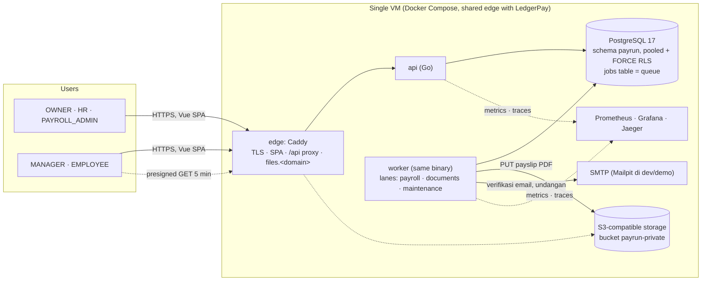
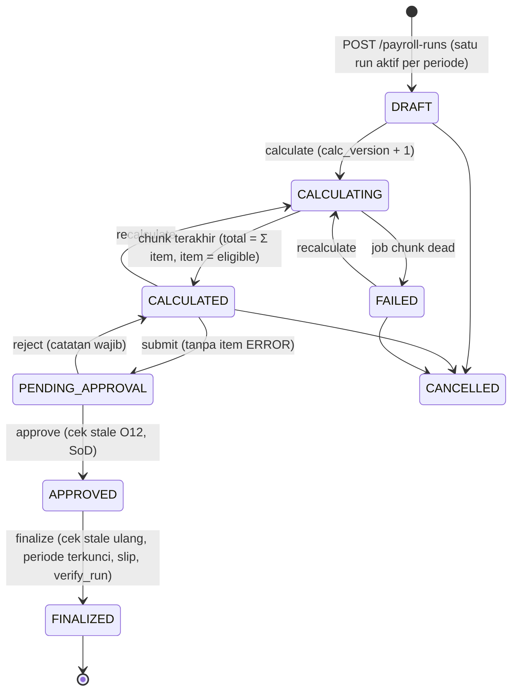

# PayRun — arsitektur

Ringkasan dari dokumen desain (`docs/design/04-architecture.md`, `06-multi-tenancy.md`, `23-background-jobs.md`)
disinkronkan dengan kode di akhir Sprint 10. Kalau berbeda, kode + ADR (termasuk amandemennya) yang berlaku.

## 1. Context & container



| Container | Tanggung jawab | Koneksi DB |
|---|---|---|
| `api` | HTTP, auth, authz matrix, validasi, transaksi bisnis + enqueue job di tx yang sama | `payrun_app` (`NOBYPASSRLS`, bukan owner; ditolak saat start kalau tidak) |
| `worker` | `payroll.plan` / `calc_chunk` / `cleanup_versions` / `verify_run`, `payslip.render`, email, maintenance | `payrun_app`; tenant dari `jobs.tenant_id` |
| `migrate` | goose up (+ `migrations_demo` di build demo) | `payrun_owner` (FORCE RLS tetap berlaku) |
| backup | `pg_dump` terenkripsi age | `payrun_backup` (satu-satunya `BYPASSRLS`, SELECT saja) |
| investigasi | runbook | `payrun_readonly` (SELECT, di bawah RLS) |

## 2. Tenant context (jalur setiap request)

```mermaid
sequenceDiagram
  participant B as Browser
  participant A as api
  participant DB as PostgreSQL
  B->>A: GET /api/v1/employees (Bearer JWT, claim tid)
  A->>A: verifikasi JWT (HS256 + kid) → tenantctx = tid; authz matrix (route × role)
  A->>DB: BEGIN
  A->>DB: SELECT set_config('app.tenant_id', tid, true)  -- berlaku untuk transaksi ini saja
  A->>DB: query sqlc (tanpa perlu WHERE tenant_id untuk keamanan)
  DB-->>A: hanya baris dengan tenant_id = current_tenant()
  A->>A: tenant guard: setiap baris yang di-decode dibandingkan dengan tid (C-46)
  A->>DB: COMMIT  -- setting hilang; koneksi kembali ke pool tanpa tenant
  A-->>B: 200 (atau 404 untuk resource tenant lain: keberadaan pun tidak bocor)
```

- `payrun.current_tenant()` mengembalikan `NULL` kalau tidak ada tenant → policy `tenant_id = NULL` → **0 baris** (fail closed).
- Mode eksklusif: transaksi tenant hanya menyetel `app.tenant_id`; transaksi platform (login, daftar membership sendiri)
  hanya menyetel `app.user_id`. Policy "self" mati di mode tenant (`TestRLS_SelfPoliciesInactiveInTenantMode`).
- Job: di-enqueue di transaksi tenant (trigger `jobs_enforce_tenant` memastikan `jobs.tenant_id` = tenant transaksi),
  di-claim tanpa tenant context, dijalankan di `WithTenantTxFor(job.TenantID)`.

## 3. Payroll run



Kalkulasi: `payroll.plan` menghitung karyawan eligible dan membagi ke chunk (default 50). Setiap `payroll.calc_chunk`:
**txRead** (REPEATABLE READ READ ONLY: input semua karyawan chunk dalam satu snapshot) → **compute** (engine pure, di
luar transaksi) → **txWrite** (lock run, cek `status` + `calc_version`, hapus item versi ini untuk karyawan chunk,
tulis item/line/snapshot dengan tiga `INSERT … unnest`, `chunks_done + 1`, `CompleteInTx` = fencing lease). Chunk
dari versi lama atau dengan lease yang dicuri tidak bisa commit.

## 4. Modul

| Modul | Isi |
|---|---|
| `tenancy`, `iam` | signup, verifikasi email, login, refresh rotation, membership + role, switch tenant |
| `org`, `employee` | departemen, posisi, penempatan effective-dated, atasan (bebas siklus), karyawan + PII terenkripsi, undangan |
| `compensation` | gaji pokok + komponen effective-dated, ruleset, hari libur |
| `attendance`, `leave`, `overtime` | input payroll dengan approval dan PeriodGuard |
| `approval` | approval generik (inbox, approve/reject, SoD) |
| `payroll` | engine (pure), run, chunk, stale detection, finalize, payslip, adjustment, verify |

Aturan import (`depguard`, `.golangci.yml`): `platform` tidak meng-import modul atau composition root; modul tidak
meng-import `internal/app`; `payroll/engine` tidak boleh meng-import db, pgx, `net`, `os`, `math/rand`, atau clock.
Ketergantungan antarmodul lewat interface yang dirakit di `internal/app` (contoh: `payroll.Approvals`,
`attendanceEmployees`).
