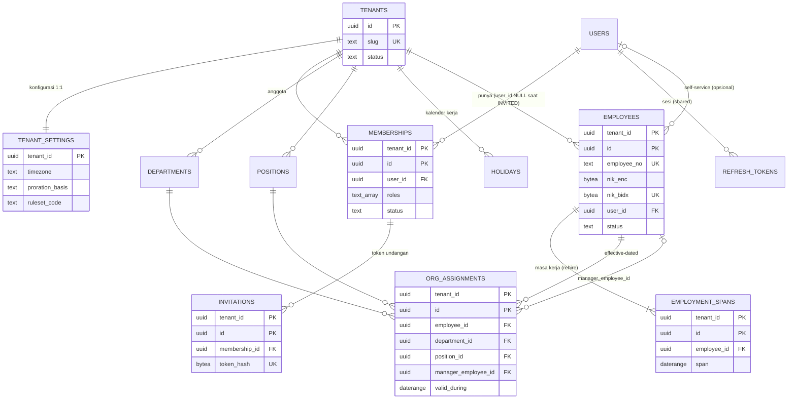
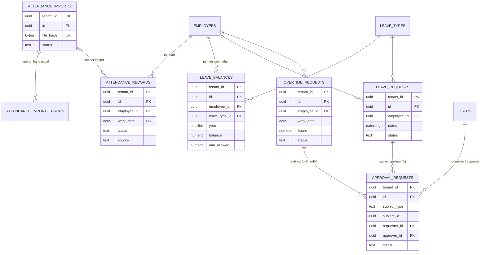

# Step 4.5 — PayRun: ERD & Daftar Tabel

> Konvensi (PK `(tenant_id, id)`, composite FK, enum `text + CHECK`, tanpa `deleted_at`, tipe numeric): [`00-index.md`](00-index.md).
> Spesifikasi kolom: [`06-payrun-schema.md`](06-payrun-schema.md). RLS, index, volume: [`07-payrun-rls-consistency-and-indexing.md`](07-payrun-rls-consistency-and-indexing.md).
> Tabel shared (`users`, `refresh_tokens`, `idempotency_keys`, `jobs`, `audit_log`) dispesifikasikan di [`01-shared-tables.md`](01-shared-tables.md). Di sini tabel-tabel itu hanya muncul sebagai node relasi.

Schema: `payrun`. Semua tabel bisnis tenant-scoped, kecuali `tenants`, `users`, dan `rulesets` (global).

---

## 1. ERD — Tenancy, IAM, Org, Employee

## 2. ERD — Time & Attendance, Approval

## 3. ERD — Compensation & Payroll

```mermaid
erDiagram
    RULESETS ||--o{ PAYROLL_ITEM_SNAPSHOTS : "versi dipakai (by code+version)"
    COMPONENT_DEFINITIONS ||--o{ EMPLOYEE_COMPONENTS : ""
    EMPLOYEES ||--o{ EMPLOYEE_COMPONENTS : "effective-dated"
    EMPLOYEES ||--o{ SALARY_ASSIGNMENTS : "effective-dated"
    PAYROLL_PERIODS ||--o{ PAYROLL_RUNS : "maks 1 aktif"
    PAYROLL_RUNS ||--o{ PAYROLL_ITEMS : "per employee per calc_version"
    EMPLOYEES ||--o{ PAYROLL_ITEMS : ""
    PAYROLL_ITEMS ||--|{ PAYROLL_LINES : "baris komponen"
    PAYROLL_ITEMS ||--|| PAYROLL_ITEM_SNAPSHOTS : "input + fingerprint"
    PAYROLL_PERIODS ||--o{ ADJUSTMENTS : "origin / target"
    PAYROLL_RUNS |o--o{ ADJUSTMENTS : "applied_run_id"
    ADJUSTMENTS |o--o{ PAYROLL_LINES : "baris ADJUSTMENT"
    PAYROLL_RUNS ||--o{ PAYSLIPS : "setelah FINALIZED"
    PAYROLL_ITEMS ||--o| PAYSLIPS : ""

    RULESETS {
        uuid id PK
        text code UK
        text version UK
        daterange valid_during
        jsonb payload
    }
    COMPONENT_DEFINITIONS {
        uuid tenant_id PK
        uuid id PK
        text code UK
        text category
        text calc_type
    }
    SALARY_ASSIGNMENTS {
        uuid tenant_id PK
        uuid id PK
        uuid employee_id FK
        numeric base_salary
        daterange valid_during
    }
    PAYROLL_PERIODS {
        uuid tenant_id PK
        uuid id PK
        smallint year UK
        smallint month UK
        text status
        timestamptz cutoff_at
    }
    PAYROLL_RUNS {
        uuid tenant_id PK
        uuid id PK
        uuid period_id FK
        text status
        int calc_version
        bytea input_fingerprint
    }
    PAYROLL_ITEMS {
        uuid tenant_id PK
        uuid id PK
        uuid run_id FK
        uuid employee_id FK
        int calc_version UK
        numeric net
    }
    PAYROLL_LINES {
        uuid tenant_id PK
        uuid id PK
        uuid item_id FK
        text code
        numeric amount
    }
    ADJUSTMENTS {
        uuid tenant_id PK
        uuid id PK
        uuid employee_id FK
        uuid applied_run_id FK
        numeric amount
        text status
    }
    PAYSLIPS {
        uuid tenant_id PK
        uuid id PK
        uuid run_id FK
        uuid employee_id FK
        text object_key UK
        text status
    }
```

> **Catatan notasi:** di ERD, PK tenant-scoped ditulis sebagai dua atribut `PK` (`tenant_id`, `id`). Semua relasi antar tabel bisnis adalah **composite FK** `(tenant_id, x_id) → parent(tenant_id, id)`. Mermaid tidak bisa menggambar composite FK secara eksplisit.
> `audit_log`, `jobs`, dan `idempotency_keys` (shared) mereferensikan hampir semua tabel secara logis (`target_type/target_id`, payload), tanpa FK fisik, sehingga tidak digambar.

---

## 4. Daftar tabel

Kolom: **Sifat**: M = mutable, A = append-only, E = effective-dated, I = immutable setelah state tertentu. **Konsistensi**: S = strong (transaksional, dijaga constraint), E = eventual (turunan / asinkron). **Estimasi baris** memakai skenario uji di `00-index.md` §8 (1.000 tenant, 100.000 employee, per tahun bila relevan).

| Tabel | Modul | Aggregate | Sifat | Tenant-scoped | Estimasi baris | Konsistensi |
|---|---|---|---|---|---|---|
| `tenants` | tenancy | Tenant | M | Global (RLS khusus) | 1.000 | S |
| `tenant_settings` | tenancy | Tenant | M | Ya (PK = `tenant_id`) | 1.000 | S |
| `users` *(shared)* | iam | — | M | Global (RLS khusus) | ~110.000 | S |
| `refresh_tokens` *(shared)* | iam | — | M (rotasi) | Global, per user | ~200.000 aktif | S |
| `memberships` | iam | Membership | M | Ya (+ policy self) | ~110.000 | S |
| `invitations` | iam | Membership | M (sekali pakai) | Ya | ~20.000 aktif (retensi) | S |
| `departments` | org | — (reference) | M, deaktivasi | Ya | ~10.000 | S |
| `positions` | org | — (reference) | M, deaktivasi | Ya | ~20.000 | S |
| `holidays` | org (kalender) | Tenant | M | Ya | ~15.000/tahun | S |
| `employees` | employee | Employee | M | Ya | 100.000 (+ alumni) | S |
| `employment_spans` | employee | Employee | E | Ya | ~110.000 | S |
| `org_assignments` | org | OrgAssignment | E | Ya | ~200.000 | S |
| `component_definitions` | compensation | ComponentDefinition | M, deaktivasi | Ya | ~15.000 | S |
| `employee_components` | compensation | SalaryAssignment | E | Ya | ~400.000 | S |
| `salary_assignments` | compensation | SalaryAssignment | E | Ya | ~250.000 | S |
| `rulesets` | compensation | Ruleset | A (immutable per versi) | **Global**, read-only bagi app | < 50 | S |
| `attendance_records` | attendance | AttendanceRecord | M (koreksi) | Ya | ~25 juta/tahun | S |
| `attendance_imports` | attendance | (job + laporan) | M (status) | Ya | ~12.000/tahun | E (hasil job) |
| `attendance_import_errors` | attendance | (laporan) | A | Ya | ~200.000/tahun | E |
| `leave_types` | leave | — (reference) | M, deaktivasi | Ya | ~5.000 | S |
| `leave_balances` | leave | LeaveBalance | M (hot row saat approve) | Ya | ~300.000/tahun | S |
| `leave_requests` | leave | LeaveRequest | M (status) | Ya | ~600.000/tahun | S |
| `overtime_requests` | overtime | OvertimeRequest | M (status) | Ya | ~1 juta/tahun | S |
| `approval_requests` | approval | ApprovalRequest | M (status) | Ya | ~1,6 juta/tahun | S |
| `payroll_periods` | payroll | PayrollPeriod | M → I (`FINALIZED`) | Ya | 12.000/tahun | S |
| `payroll_runs` | payroll | PayrollRun | M → I (`FINALIZED`/`CANCELLED`) | Ya | ~15.000/tahun | S |
| `payroll_items` | payroll | PayrollRun | M → I | Ya | ~1,2 juta/tahun (+ versi lama sementara) | S |
| `payroll_lines` | payroll | PayrollRun | A → I | Ya | ~15 juta/tahun | S |
| `payroll_item_snapshots` | payroll | PayrollRun | A → I | Ya | ~1,2 juta/tahun | S |
| `adjustments` | payroll | Adjustment | M → I (`APPLIED`) | Ya | ~50.000/tahun | S |
| `payslips` | payslip | Payslip | M (status render) | Ya | ~1,2 juta/tahun | **E** (PDF dirender async) |
| `idempotency_keys` *(shared)* | platform | — | A, efemeral | Ya | ~50.000 aktif | S |
| `platform_idempotency_keys` *(shared)* | tenancy | — | A, efemeral | Global (tanpa RLS, hanya signup) | < 1.000 aktif | S |
| `jobs` *(shared)* | platform | — | M, efemeral | `tenant_id` di kolom, **bukan** RLS tenant (lihat `07` §2.4) | < 1 juta aktif | S (outbox) |
| `audit_log` *(shared, varian PayRun)* | audit | AuditEntry | A | Ya | ~10 juta/tahun | S (ditulis di tx yang sama) |

### Tabel yang sengaja **tidak** ada

| Tidak ada | Alasan |
|---|---|
| `membership_roles` | Role disimpan sebagai `text[]` di `memberships` (alasan di `06` §3) |
| `work_calendars` | Satu kalender per tenant: hari kerja mingguan di `tenant_settings.work_days` + tabel `holidays`. Multi-kalender (per lokasi/shift) di luar cakupan V1 |
| `payroll_run_versions` | Riwayat kalkulasi = `calc_version` di item. Versi lama dihapus setelah versi baru `CALCULATED` (ADR-P05) |
| `reports_*` / read model | Laporan (P3) dihitung on-the-fly dari tabel sumber. Read model baru dibuat kalau terbukti lambat |
| Tabel `deleted_*` / kolom `deleted_at` | Lihat strategi soft delete di `00-index.md` §5 |

### Ownership modul → tabel (untuk depguard & review)

| Modul | Tabel yang boleh ditulis |
|---|---|
| `tenancy` | `tenants`, `tenant_settings`, `holidays` |
| `iam` | `users`, `refresh_tokens`, `memberships`, `invitations` |
| `org` | `departments`, `positions`, `org_assignments` |
| `employee` | `employees`, `employment_spans` |
| `compensation` | `component_definitions`, `employee_components`, `salary_assignments` (`rulesets` hanya lewat migrasi) |
| `attendance` | `attendance_records`, `attendance_imports`, `attendance_import_errors` |
| `leave` | `leave_types`, `leave_balances`, `leave_requests` |
| `overtime` | `overtime_requests` |
| `approval` | `approval_requests` (efek ke subjek lewat interface modul pemilik, di transaksi yang sama) |
| `payroll` | `payroll_periods`, `payroll_runs`, `payroll_items`, `payroll_lines`, `payroll_item_snapshots`, `adjustments` |
| `payslip` | `payslips` |
| `platform` | `idempotency_keys`, `jobs` (`platform_idempotency_keys` hanya modul `tenancy`); `audit_log` ditulis lewat helper `audit.Record(tx, …)` dari modul mana pun |
